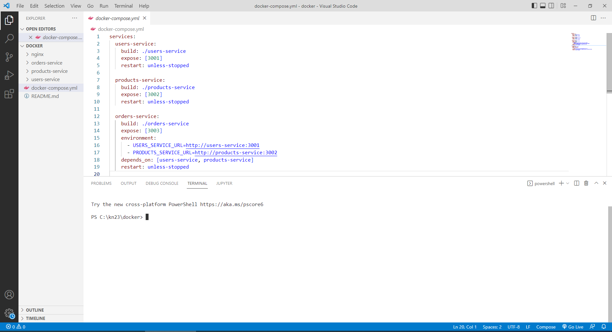
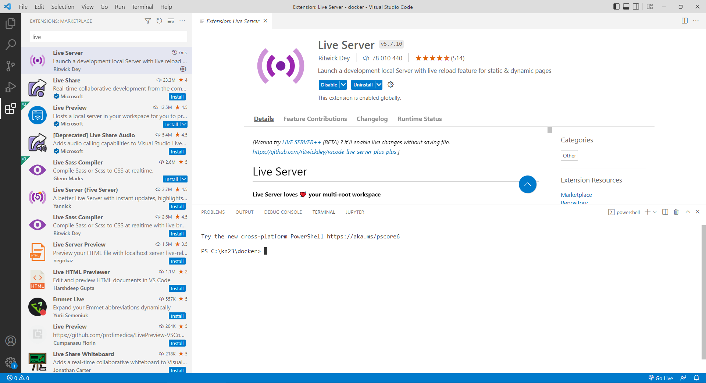

## РОЗДІЛ 1. ВИМОГИ ТА ПІДГОТОВКА РОБОЧОГО СЕРЕДОВИЩА

#### 1.1 Робота зі спеціалізованим ПЗ та середовищами (IDE)

##### 1.1.1 Огляд редакторів коду та їх можливостей

Перш ніж розпочати процес розробки програмного забезпечення, необхідно обрати та налаштувати базовий інструментарій — **редактор коду** або **інтегроване середовище розробки (IDE — Integrated Development Environment)**. Від правильного вибору інструмента безпосередньо залежить продуктивність, зручність навігації у проєкті та швидкість виявлення синтаксичних чи логічних помилок.

**Різниця між текстовим редактором та IDE:**

- **Текстовий редактор (Text Editor):** Полегшена програма для базової роботи з текстом, що підтримує підсвічування коду (наприклад, Sublime Text чи Notepad++). У базовій комплектації він не розуміє архітектуру чи семантику вашого проєкту.
- **Редактор коду (Code Editor):** Більш просунутий інструмент, орієнтований виключно на розробників. Він зберігає високу швидкість запуску, має потужний базовий функціонал (підсвічування, інтелектуальне автодоповнення) і легко масштабується за допомогою плагінів. Беззаперечним лідером у цій категорії є **Visual Studio Code (VS Code)**.
- **IDE (Integrated Development Environment):** Комплексне програмне забезпечення, що "з коробки" містить редактор коду, компілятор/інтерпретатор, вбудований термінал, систему автоматизації збірки коду, інструменти тестування та глибинну інтеграцію з системами контролю версій (VCS). Популярні представники: лінійка продуктів від JetBrains (**WebStorm**, **PyCharm**, **IntelliJ IDEA**) та **Visual Studio** (від Microsoft).

**Порівняльна таблиця: Текстовий редактор vs Редактор коду vs IDE**

| Характеристика / Функціональність  |    Текстовий редактор     |             Редактор коду             |         IDE (Інтегроване середовище)          |
| :--------------------------------- | :-----------------------: | :-----------------------------------: | :-------------------------------------------: |
| **Призначення**                    | Базові правки тексту/коду | Написання та базове налагодження коду | Повний цикл розробки програмного забезпечення |
| **Підсвічування синтаксису**       |            ✅             |                  ✅                   |                      ✅                       |
| **Автодоповнення (IntelliSense)**  |            ❌             |                  ✅                   |                      ✅                       |
| **Вбудований термінал**            |            ❌             |                  ✅                   |                      ✅                       |
| **Інтеграція з Git (VCS)**         |            ❌             |                  ✅                   |                      ✅                       |
| **Підтримка плагінів**             |         Обмежена          |        ✅ (Велика екосистема)         |       ✅ (Часто вбудовано "з коробки")        |
| **Вбудований компілятор / збірка** |            ❌             |     ❌ (досягається розширеннями)     |                      ✅                       |
| **Розуміння архітектури проєкту**  |            ❌             |           Часткове / Базове           |          ✅ (Повний аналіз зв'язків)          |
| **Споживання системних ресурсів**  |          Низьке           |                Середнє                |                    Високе                     |
| **Типові представники**            |  Notepad++, Sublime Text  |            VS Code, Cursor            |       WebStorm, Visual Studio, PyCharm        |

**Основні можливості сучасних редакторів коду:**

Сучасна межа між редактором коду та IDE поступово стирається завдяки системі розширень. Однак, сучасний редактор гарантовано має забезпечувати наступні базові можливості:

1.  **Підсвічування синтаксису (Syntax Highlighting):** Різні елементи кодової бази (змінні, функції, зарезервовані слова) відображаються різними кольорами, що покращує читабельність та знижує когнітивне навантаження.
2.  **Автодоповнення (IntelliSense / Autocomplete):** Розумні семантичні підказки під час написання коду на основі контексту (назв методів, імпортованих бібліотек, типів змінних), що мінімізує синтаксичні помилки (typos).
3.  **Вбудований термінал (Integrated Terminal):** Дозволяє виконувати консольні команди (напр., запуск сервера розробки, інсталяція пакетів, виконання Git-команд), не перемикаючись на окреме вікно операційної системи.
4.  **Інтеграція з системами контролю версій (VCS Integration):** Візуальне відображення змінених файлів, паралельне порівняння змін (diff), зручне створення комітів (commits) та розв'язання конфліктів при злитті гілок (merge conflicts).
5.  **Налагодження коду (Debugging):** Можливість зупинки виконання програми в певній точці (breakpoints) для покрокового відстеження виконання алгоритму та перевірки поточних значень змінних.


Робоче вікно сучасного редактора коду

Вибір середовища часто є суб'єктивним, проте на даному етапі розвитку індустрії (особливо для екосистеми веб-розробки) стандартом де-факто став редактор, який забезпечує найкращий баланс між продуктивністю операційної системи та широтою функціоналу завдяки відкритій екосистемі плагінів.

##### 1.1.2 Встановлення та базова конфігурація Visual Studio Code

**Visual Studio Code (VS Code)** — це безкоштовний, кросплатформний редактор коду з відкритим сирцевим кодом (open-source), розроблений компанією Microsoft. Завдяки високій продуктивності та величезній екосистемі розширень, він є стандартом індустрії для веб-розробки та багатьох інших напрямків.

**Крок 1: Завантаження та встановлення**

1. Перейдіть на офіційний сайт продукту: [code.visualstudio.com](https://code.visualstudio.com/).
2. Завантажте стабільну версію (Stable Build) інсталятора для вашої операційної системи (Windows, macOS або Linux).
3. Запустіть інсталятор та дотримуйтесь інструкцій на екрані.
4. **Важливо для користувачів Windows:** Під час вибору додаткових завдань (Select Additional Tasks) обов'язково встановіть наступні прапорці:
   - **"Add 'Open with Code' action to Windows Explorer file context menu"** (Додати дію "Відкрити за допомогою Code" у контекстне меню файлу) — це дозволить швидко відкривати будь-яку папку як проєкт в VS Code.
   - **"Add 'Open with Code' action to Windows Explorer directory context menu"** (Додати дію "Відкрити за допомогою Code" у контекстне меню каталогу).
   - **"Add to PATH (requires shell restart)"** (Додати до PATH) — критично важливо для можливості запуску редактора з терміналу командою `code .`.

**Крок 2: Перший запуск та знайомство з інтерфейсом**

Після першого запуску вас зустріне екран привітання (Welcome Сreen). Рекомендується одразу обрати зручну для очей колірну тему (зазвичай Dark Mode є кращим вибором для тривалої роботи, оскільки зменшує навантаження на зір).

Інтерфейс VS Code логічно розділений на п'ять основних візуальних зон:

1. **Рядок активності (Activity Bar):** Вузька вертикальна панель ліворуч (за замовчуванням). Дозволяє перемикатися між основними режимами: Провідник (Еxplorer), Пошук (Search), Контроль версій (Source Control, зазвичай Git), Налагодження (Run and Debug) та Розширення (Extensions).
2. **Бічна панель (Side Bar):** Відображає вміст, специфічний для обраного режиму в Рядку активності (наприклад, дерево файлів та папок вашого проєкту, якщо ви в режимі Explorer).
3. **Область редактора (Editor Groups):** Основний робочий простір, де ви безпосередньо пишете код. Можна відкривати кілька файлів одночасно у вкладках або розділяти екран вертикально чи горизонтально для паралельного перегляду коду.
4. **Нижня панель (Panel):** Розташована традиційно під редактором коду. Містить Інтегрований термінал (Terminal), вивід системи (Output), консоль відлагодження (Debug Console) та інформацію про проблеми в коді (Problems). Відкривається або закривається за допомогою комбінації клавіш `` Ctrl + ` `` (зворотний апостроф), або через меню `View -> Terminal`.
5. **Рядок стану (Status Bar):** Вузька смуга в самому низу вікна, що показує поточні параметри відкритого файлу (кодування, розмір відступів, поточна гілка Git, стан лінтерів або підключення до сервера).

**Крок 3: Синхронізація налаштувань (Settings Sync)**

Оскільки студентам часто доводиться працювати як в аудиторіях, так і вдома на власних пристроях, налаштовувати середовище з нуля щоразу вкрай непродуктивно. У VS Code вбудована функція синхронізації налаштувань:

1. Натисніть на іконку профілю (Accounts) у нижньому лівому куті (на Рядку активності).
2. Оберіть пункт **"Turn on Settings Sync..."**.
3. Авторизуйтесь за допомогою свого облікового запису GitHub або Microsoft.
4. Тепер усі ваші налаштування графічного інтерфейсу, гарячі клавіші та перелік встановлених розширень (плагінів) будуть автоматично зберігатися у хмарі та підтягуватися після авторизації на новому комп'ютері.

##### 1.1.3 Сучасні аналоги VS Code та AI-first середовища (Cursor, Windsurf, Trae, Zed, Antigravity)

Хоча Visual Studio Code залишається базовим стандартом індустрії, останніми роками інструментарій веброзробника зазнав фундаментальної трансформації. З'явилася нова генерація редакторів та інтегрованих середовищ розробки, які побудовані безпосередньо навколо штучного інтелекту (AI-first / Agentic IDE) або пропонують принципово іншу архітектуру продуктивності та спільної роботи.

Розглянемо ключові сучасні альтернативи, їхні технологічні особливості та сфери застосування.

**1. Cursor IDE ("The AI-first Code Editor")**

Cursor став першим масовим редактором, що популяризував концепцію AI-first розробки. Побудований як відкритий форк VS Code (VSCodium), він підтримує звичний інтерфейс, усі теми, гарячі клавіші та розширення з оригінального маркетплейсу, проте кардинально змінює спосіб взаємодії з кодом.

- **Ключові можливості:**
  - **Швидке інлайн-редагування (Ctrl+K / Cmd+K):** виділивши будь-який блок коду, можна природною мовою сформулювати запит на зміну (наприклад: _"додай типізацію аргументів та обробку PDOException"_ або _"перепиши цей цикл на array_map"_);
  - **Глибокий контекстний чат (Ctrl+L / Cmd+L):** чат з LLM, який автоматично індексує та аналізує взаємозв'язки всієї кодової бази проєкту. За допомогою символу `@` до контексту можна додавати окремі файли (`@Files`), папки (`@Folders`), документацію (`@Docs`) чи вебпосилання;
  - **Багаторядкове автодоповнення (Copilot++ / Tab Prediction):** інтелектуальна модель наперед передбачає кілька наступних рядків коду, враховуючи останні правки в сусідніх файлах проєкту;
  - **Composer (Ctrl+I / Cmd+I):** режим мультифайлового генерування, де ШІ самостійно створює нові файли або модифікує кілька модулів одночасно в межах однієї задачі.

**2. Windsurf (від Codeium, "The First Agentic IDE")**

Windsurf — середовище розробки від компанії Codeium, що реалізує концепцію **агентної IDE (Agentic IDE)**. На відміну від звичайних AI-асистентів, які лише відповідають на запити, Windsurf працює в парадигмі спільної синхронної взаємодії — **Flow State**.

- **Ключові можливості:**
  - **Асистент Cascade:** автономний агент, що діє як повноправний напарник. Він не просто генерує код, а самостійно зчитує контекст проєкту, відстежує помилки лінтера та компілятора в реальному часі, запускає команди в терміналі та пропонує комплексні рішення;
  - **Концепція Flow:** система мінімізує тертя між діями користувача та реакціями ШІ. Асистент самостійно перемикається між файлами, тримаючи в пам'яті ланцюжок змін;
  - **Supercomplete:** просунуте контекстне автодоповнення, яке передбачає не лише наступні символи, а й перехід курсора до потрібного місця в коді для виконання наступного логічного кроку;
  - **Повна сумісність із екосистемою VS Code:** легка міграція налаштувань, шорткатів та розширень.

**3. Trae (від ByteDance)**

Trae — сучасне адаптивне AI-середовище розробки від компанії ByteDance, створене на базі відкритого ядра VS Code. Його ключовою перевагою є надання безкоштовного доступу до передових мовних моделей комерційного рівня без необхідності підключення власних API-ключів.

- **Ключові можливості:**
  - **Доступ до моделей топового класу:** редактор «з коробки» підтримує передові моделі (Claude 3.5 Sonnet, GPT-4o), що забезпечує високу точність генерації коду, розуміння архітектурних патернів та логіки;
  - **Режим Builder (Автономний агент):** дозволяє передати завдання на створення цілого модуля або вебпроєкту. Builder самостійно проєктує структуру файлів, пише код у кількох файлах одночасно та виконує збірку або встановлення залежностей у вбудованому терміналі;
  - **Chat Mode та контекстні теги:** інтерактивний чат із підтримкою контекстних посилань на файли (`#file`) та робоче середовище (`#workspace`);
  - **Підтримка української мови та дружній інтерфейс:** оптимізований робочий простір із можливістю гнучкого перемикання між ручним кодуванням та агентним режимом.

**4. Zed ("High-Performance Code Editor")**

Zed займає особливе місце серед сучасних редакторів, оскільки принципово відрізняється від родини VS Code. Він розроблений авторами популярного редактора Atom та рушія Tree-sitter з нуля на системній мові **Rust**. Головна філософія Zed — безкомпромісна швидкість та ефективне використання ресурсів.

- **Ключові можливості:**
  - **Екстремальна продуктивність (GPU-прискорення):** інтерфейс відмальовується безпосередньо за допомогою графічного процесора (GPU) з частотою до 120+ кадрів на секунду. Редактор запускається практично миттєво, не має лагів при відкритті гігабайтних файлів і споживає в рази менше оперативної пам'яті, ніж середовища на базі вебтехнологій (Electron);
  - **Нативна колаборація (Zed Channels):** вбудований функціонал спільного редагування коду в реальному часі (Multiplayer Editing) та голосового спілкування прямо всередині редактора без встановлення сторонніх плагінів;
  - **Вбудована AI Assistant Panel:** прозоре підключення провайдерів ШІ (Anthropic Claude, OpenAI, GitHub Copilot або локальні моделі через Ollama) з повним контролем за витратою токенів та структурою контексту;
  - **Мінімалізм та точність:** відсутність візуального шуму, швидка система навігації та вбудована інтеграція з мовними серверами (LSP) для перевірки типів і автодоповнення.

**5. Antigravity IDE / Агентні платформи**

Antigravity IDE та споріднені агентні платформи представляють найвищий рівень автономності ШІ в розробці ПЗ, фокусуючись на концепції повноцінного парного програмування (AI Pair Programmer).

- **Ключові можливості:**
  - **Виконання складних багатоетапних цілей:** користувач формулює високорівневу задачу (наприклад, _"розгорни базу даних MySQL, реалізуй міграції для таблиці задач, напиши REST API контролери та покрий їх тестами"_), а агент автономно розбиває її на підзадачі, відстежуючи їх виконання;
  - **Повноцінне володіння робочим оточенням:** асистент має доступ до терміналу, файлової системи, засобів діагностики та браузера для верифікації результатів верстки чи відповідей серверних скриптів;
  - **Система правил та навичок (Skills & Rules):** можливість кастомізації поведінки агента під специфіку репозиторію, стеку технологій та навчальних вимог.

---

### Зведена таблиця характеристик сучасних редакторів

| Редактор | Базова платформа / Технологія | Споживання RAM / Швидкодія | Основні AI-можливості | Режим роботи ШІ | Підтримка плагінів VS Code |
| :--- | :--- | :---: | :--- | :--- | :---: |
| **VS Code** | Electron / TypeScript | Середнє | Додаються через плагіни (Copilot, Tabnine) | Автодоповнення / Чат | Повна (Рідний маркетплейс) |
| **Cursor** | Форк VS Code (VSCodium) | Середнє | Вбудовані Composer, Chat, Ctrl+K, Copilot++ | Чат / Редагування файлів | Повна |
| **Windsurf** | Форк VS Code | Середнє | Cascade Agent, Supercomplete, Flow State | Агентний (Flow) / Автономний | Повна |
| **Trae** | Форк VS Code | Середнє | Вбудовані Claude 3.5 Sonnet / GPT-4o, Builder | Агентний (Builder) / Чат | Повна |
| **Zed** | Власне ядро на **Rust** (GPU) | **Мінімальне** (у 3–5 разів швидше) | Вбудована панель асистента (Bring Your Own Key) | Чат / Трансформація виділення | Власний каталог розширень |
| **Antigravity** | Форк VS Code / Agentic Runtime | Середнє | Повноцінний автономний агент, робота з терміналом та ОС | Агентний (Pair Programming) | Повна |

---

**Рекомендації для здобувачів вищої освіти:**

- **1–2 курси (Базовий рівень):** для опанування синтаксису мов (HTML5, CSS3, базова алгоритмізація в JS та PHP) наполегливо рекомендується працювати у **VS Code** або надшвидкому **Zed** із вимкненими генеративними підказками. Студент повинен спочатку сформувати власне моторне та логічне відчуття коду, запам'ятати структуру тегів і поведінку циклів без автоматичного автодоповнення.
- **Старші курси та командні проєкти (Просунутий рівень):** під час розробки наскрізних вебзастосунків, мікросервісних систем, налаштування CI/CD та виконання курсових або дипломних робіт використання **Cursor**, **Windsurf**, **Trae** або **Antigravity IDE** є виправданим і корисним кроком, оскільки формує практичні навички промпт-інжинірингу та роботи з сучасними AI-асистентами, що є обов'язковою вимогою сучасного ІТ-ринку.

##### 1.1.4 Розширення (плагіни): як шукати, встановлювати та на що звертати увагу

Сила сучасних редакторів коду, таких як VS Code, полягає в їхній модульності. Розширення (Extensions або Plugins) дозволяють додати до редактора підтримку нових мов програмування, лінтерів, тем оформлення, інтеграцій з хмарними сервісами та багато іншого.

**Як знайти та встановити розширення:**

1. Відкрийте панель розширень, натиснувши іконку **Extensions** на Рядку активності (ліворуч) або скористайтеся гарячими клавішами `Ctrl+Shift+X` (`Cmd+Shift+X` на Mac).
2. У рядку пошуку введіть назву потрібного плагіна або ключове слово (наприклад, _"Python"_, _"Live Server"_, _"Git"_).
3. У списку результатів оберіть необхідне розширення та натисніть кнопку **Install**.


Панель розширень (Extensions Market) у VS Code. У рядку пошуку введено запит, а в результатах червоною рамкою виділено кнопку "Install" біля обраного плагіна

**Критерії вибору надійного розширення:**

Магазин розширень (Marketplace) є відкритим, тому там можуть траплятися застарілі, неякісні або навіть шкідливі плагіни. Перед встановленням будь-якого розширення **обов'язково звертайте увагу на такі чотири фактори**, які відображаються поруч із його назвою:

- **Автор (Publisher):** Якщо ви шукаєте офіційну підтримку мови чи фреймворку, перевірте, чи відповідає автор очікуванням. Наприклад, офіційне розширення для Python має бути від _Microsoft_, а для Prettier — від _Prettier_. Часто біля імені перевіреного автора стоїть синя галочка (Verified).
- **Кількість завантажень (Downloads):** Це найкращий індикатор популярності. Розширення з кількома мільйонами завантажень (позначається літерою `M`, наприклад, `10M`) є галузевим стандартом. Якщо ви бачите плагін зі схожою назвою, але з 2 тисячами завантажень, це, швидше за все, погана копія.
- **Рейтинг та відгуки (Rating):** Відображається у вигляді зірочок (від 1 до 5). Рейтинг вище 4.5 зазвичай свідчить про стабільну роботу плагіна. Також варто звертати увагу на кількість залишених оцінок у дужках.
- **Дата останнього оновлення (Last Updated):** Натисніть на розширення, щоб відкрити його детальну сторінку, і перевірте дату оновлення. Якщо плагін не оновлювався 3–5 років, ймовірно, його розвиток припинено, і можуть виникати конфлікти з новими версіями VS Code.

**Управління розширеннями:**
Встановлені розширення можна конфігурувати (іконка шестірні ⚙️ біля назви плагіна), тимчасово вимикати (**Disable**), якщо вони конфліктують або споживають забагато пам'яті, або повністю видаляти (**Uninstall**).

##### 1.1.5 Корисні розширення для веброзробки та не тільки

Для того щоб перетворити стандартний редактор на повноцінну робочу станцію веб-розробника, рекомендується встановити базовий набір розширень, які автоматизують рутинні процеси.

**Обов'язковий мінімум для старту:**

1.  **Live Server (автор: Ritwick Dey)**
    - **Призначення:** Запускає локальний сервер розробки з функцією "живого перезавантаження" (live reload). Під час збереження змін у HTML/CSS/JS файлах (`Ctrl+S`), сторінка в браузері автоматично оновлюється без необхідності натискати F5.
    - **Як користуватись:** Відкрийте HTML-файл і натисніть кнопку **"Go Live"** на нижньому Рядку стану (Status Bar) або клацніть правою кнопкою миші у файлі та оберіть "Open with Live Server".

2.  **Prettier - Code formatter (автор: Prettier)**
    - **Призначення:** "Охайний" код — це стандарт індустрії. Prettier автоматично вирівнює відступи, розставляє перенесення рядків та лапки згідно з єдиним стандартом. (Детальніше про його налаштування — у п. 1.1.7).

3.  **GitLens — Git supercharged (автор: GitKraken)**
    - **Призначення:** Екстремально посилює вбудовані можливості Git. Головна фішка — **Git Blame annotations**. Навівши курсор на будь-який рядок коду, ви одразу бачите тьмяний текст із зазначенням того, _хто, коли і в якому коміті_ написав або змінив цей конкретний рядок.

**Додаткові розширення (за специфікою):**

4.  **Auto Rename Tag (автор: Jun Han)**
    - **Призначення:** При зміні відкриваючого HTML/XML тегу (наприклад, `<div>` на `<section>`), розширення автоматично та миттєво змінює відповідний закриваючий тег (`</div>` на `</section>`), що економить час і запобігає появі невалідного HTML.
5.  **ESLint / TSLint (автор: Microsoft)**
    - **Призначення:** Лінтер, який "на льоту" статично перевіряє ваш JavaScript/TypeScript код на наявність синтаксичних та логічних помилок ще до його запуску, підкреслюючи проблемні місця червоними хвилястими лініями.
6.  **DotENV (автор: mikestead)**
    - **Призначення:** Додає коректне підсвічування синтаксису для файлів конфігурації `.env`, де зберігаються секрети та ключі бази даних (робить їх легкочитними замість чорно-білого тексту).
7.  **Thunder Client або Postman (як плагін)**
    - **Призначення:** Легковагі інструменти (GUI) для тестування API (відправка GET/POST/PUT/DELETE запитів) безпосередньо з вікна редактора, не відкриваючи браузер чи окрему програму великого розміру.

##### 1.1.6 Стандарти коду та лінтери (ESLint / Prettier, PEP 8, PSR)

У сучасній розробці програмного забезпечення код майже ніколи не пишеться однією людиною ізольовано. Він читається, модифікується та підтримується багатьма розробниками протягом тривалого часу. Саме тому в індустрії існують **стандарти написання коду (Code Conventions)** — набори правил, які визначають, як саме повинен бути оформлений код у конкретній мові програмування.

Недотримання стандартів не обов'язково зламає програму, але зробить її "нечитабельною" для інших програмістів (так званий "брудний код" або _spaghetti code_).

Для автоматизації перевірки коду на відповідність стандартам існують спеціальні інструменти:

- **Code Formatters (Форматувальники):** Відповідають виключно за "косметичний" вигляд коду — розставляють відступи (tab/spaces), перенесення рядків, максимальну довжину рядка, типи лапок (одинарні чи подвійні).
- **Linters (Лінтери):** Утиліти статичного аналізу. Вони шукають не лише проблеми з формою, але й **синтаксичні та логічні помилки**, невикористані змінні, або використання застарілих (deprecated) функцій.

**Основні стандарти за мовами програмування:**

1.  **JavaScript / TypeScript:**
    - **Prettier:** Найпопулярніший форматувальник. Він жорстко, але надійно приводить увесь код до єдиного стилю.
    - **ESLint:** Найпотужніший лінтер для екосистеми JS. У связці з Prettier вони утворюють стандартний дует: ESLint попереджає про логічні помилки, а Prettier бере на себе візуальне вирівнювання.

2.  **Python (стандарт PEP 8):**
    - У Python відступи мають критичне значення для логіки виконання, тому стиль коду тут ще важливіший. Стандарт **PEP 8** описує все: від довжини рядка (не більше 79 символів) до того, як називати класи (CamelCase) та змінні (snake_case).
    - _Інструменти:_ Розширення _Pylint_ або _Flake8_ (лінтери), а також _Black_ (один з найсуворіших форматувальників для Python).

3.  **PHP (стандарт PSR):**
    - В екосистемі PHP стандартизацією займається група PHP-FIG (Framework Interop Group). Основні стандарти кодування — це **PSR-1** (базові правила) та **PSR-12** (розширений стиль).
    - _Інструменти:_ Найчастіше використовується розширення _PHP Intelephense_ (для підказок) та утиліта _PHP_CodeSniffer_, яка перевіряє код на відповідність стандартам PSR.

Вивчення та використання лінтерів з перших днів навчання гарантує, що ваш стиль кодування відповідатиме вимогам більшості IT-компаній.

##### 1.1.7 Налаштування `settings.json` та автоформатування при збереженні (Format on Save)

Усі налаштування інтегрованого середовища VS Code зберігаються у форматі JSON. Користувач може змінювати їх через графічний інтерфейс (Settings UI) або редагуючи конфігураційний файл `settings.json` безпосередньо. Останній варіант є більш професійним, оскільки дозволяє легко копіювати та переносити конфігурацію між різними пристроями.

**Як відкрити `settings.json`:**

1. Відкрийте палітру команд за допомогою гарячих клавіш `Ctrl+Shift+P` (`Cmd+Shift+P` на macOS).
2. Введіть пошуковий запит: **`Preferences: Open User Settings (JSON)`**.
3. Натисніть `Enter`.

Для того щоб ваш код завжди виглядав охайно і відповідав встановленим стандартам без зайвих зусиль, **категорично рекомендується** увімкнути функцію "Format on Save" (Форматувати при збереженні).

**Базовий шаблон налаштувань для веб-розробника:**

Додайте наступний код у відкритий файл `settings.json`:

```json
{
  // Увімкнути автоформатування під час кожного збереження файлу (Ctrl+S)
  "editor.formatOnSave": true,

  // Встановити Prettier як форматувальник за замовчуванням
  "editor.defaultFormatter": "esbenp.prettier-vscode",

  // Робити автоматичне збереження, коли вікно VS Code втрачає фокус
  "files.autoSave": "onFocusChange",

  // Специфічні налаштування для HTML: не переносити атрибути на нові рядки без потреби
  "html.format.wrapLineLength": 120,

  // Вимкнути мінікарту коду для економії місця на екрані (за бажанням)
  "editor.minimap.enabled": false,

  // Автоматично видаляти зайві пробіли в кінці рядків при збереженні
  "files.trimTrailingWhitespace": true
}
```

Після збереження цього файлу (`Ctrl+S`), VS Code автоматично застосує нові налаштування. Тепер, щоразу коли ви намагатиметеся зберегти "брудний" код (з кривими відступами чи різними лапками), Prettier (або інший обраний форматувальник) миттєво вирівняє його перед записом на жорсткий диск.

##### 1.1.8 Налагодження коду (Debugging): використання вбудованого дебагера

Найчастіший підхід розробників-початківців до пошуку помилок — виведення проміжних значень у консоль (наприклад, `print(x)` у Python або `console.log(x)` у JavaScript). Цей метод є простим, але вкрай неефективним для складних проєктів, оскільки після вирішення проблеми розробнику доводиться вручну видаляти весь цей «сміттєвий» код.

Професійною альтернативою є **дебагер (Debugger)** — вбудований в IDE інструмент, що дозволяє:

- Зупиняти (заморожувати) виконання програми в конкретному рядку коду.
- Інспектувати (переглядати) поточні значення всіх змінних у пам'яті на момент зупинки.
- Виконувати програму покроково (рядок за рядком).

**Три ключові сутності дебагера VS Code:**

1.  **Точки зупину (Breakpoints)**
    - **Що це:** Маркер на конкретному рядку коду, який інструктує середовище призупинити виконання програми перед тим, як цей рядок буде виконано.
    - **Як ставити:** Наведіть курсор зліва від номера рядку (у так званий _Gutter margin_) і натисніть лівою кнопкою миші. Напроти рядка з'явиться **червона крапка**. Під час зупинки рядок підсвітиться жовтим кольором, вказуючи, де саме зараз заморожено виконання.

2.  **Панель спостереження (Watch)**
    - **Що це:** Спеціальний блок на бічній панелі (у розділі Run and Debug), де ви можете власноруч додати вирази або змінні, за зміною яких хочете стежити "наживо" під час покрокового виконання.
    - **Як використовувати:** Натисніть значок `+` у панелі **Watch** і введіть ім'я змінної (наприклад, `user.role` або `counter * 2`). Жодного разу не використовуючи `console.log`, ви побачите значення цього виразу, як тільки програма зупиниться на Breakpoint.

3.  **Стек викликів (Call Stack)**
    - **Що це:** Найпотужніший інструмент пошуку причини бага. Call Stack показує **історію (ланцюжок) викликів функцій**, які призвели до поточного місця виконання.
    - **Як використовувати:** Якщо ви зупинилися на помилці в глибині функції `С`, Call Stack покаже, що функцію `C` викликала функція `B`, а її — функція `A`. Клікнувши на будь-який рядок у стеку, редактор миттєво перекине вас у файл та код тієї функції, щоб ви побачили, з якими аргументами вона була запущена.

**Типовий "Developer Flow" під час налагодження:**

1. Поставити Breakpoint (червону крапку) перед рядком коду, який, на вашу думку, працює некоректно.
2. Запустити скрипт у режимі Debug (кнопка `Run and Debug` на бічній панелі або клавіша `F5`).
3. Коли виконання зупиниться, використовувати навігаційну панель зверху (`Step Over` - перейти на наступний рядок, `Step Into` - зайти всередину функції).
4. Одночасно аналізувати значення на панелях `Variables` та `Watch`.

##### 1.1.9 Гарячі клавіші (Hotkeys) для ефективної роботи

Безперервна робота з мишею суттєво сповільнює процес написання коду. Професійні розробники намагаються виконувати від 80% до 90% рутинних дій в IDE за допомогою клавіатури.

**Топ найпопулярніших гарячих клавіш у VS Code (для Windows/Linux; на macOS зазвичай `Ctrl` замінюється на `Cmd`, а `Alt` на `Option`):**

- **Навігація:**
  - `Ctrl + P`: Швидкий пошук та відкриття будь-якого файлу у проєкті за його назвою (Quick Open).
  - `Ctrl + Shift + F`: Глобальний пошук тексту по всіх файлах відкритої папки (проєкту).
  - `Ctrl + B`: Сховати або показати бічну панель (Side Bar), щоб звільнити місце на екрані для коду.
  - `` Ctrl + ` `` _(зворотний апостроф)_: Відкрити/сховати вбудований термінал.
- **Редагування:**
  - `Ctrl + D`: Виділити поточне слово. Натискаючи комбінацію повторно, ви виділите наступні однакові слова у файлі для їх одночасного мульти-редагування.
  - `Alt + Клік мишею`: Поставити кілька курсорів у різних частинах файлу для одночасного набору тексту.
  - `Alt + Вгору/Вниз`: Перемістити поточний рядок (або виділений блок) коду вище/нижче без необхідності копіювати та вставляти (`Ctrl+C` -> `Ctrl+V`).

**Як налаштувати гарячі клавіші (Keyboard Shortcuts)**

Якщо базова комбінація вам незручна або ви звикли до гарячих клавіш з іншої IDE (наприклад, WebStorm), їх можна легко змінити:

1. Відкрийте графічний інтерфейс налаштувань комбінацій через меню `File -> Preferences -> Keyboard Shortcuts` (або `Ctrl+K` потім `Ctrl+S`).
2. У рядку пошуку введіть назву дії (наприклад, _"copy line down"_).
3. Двічі клікніть по потрібній дії у списку і натисніть на клавіатурі нову бажану комбінацію клавіш. Натисніть `Enter` для підтвердження.

**Конфлікти гарячих клавіш (Keybinding Conflicts)**

Однією з найчастіших проблем при встановленні великої кількості розширень є виникнення конфліктів комбінацій. Конфлікт виникає, коли **на одну й ту саму комбінацію (наприклад, `Ctrl+Shift+L`) призначені дві різні дії** від різних плагінів або вбудованих функцій.

_Як виявити та вирішити конфлікт:_

- Коли ви намагаєтесь призначити нову комбінацію в `Keyboard Shortcuts`, і вона вже зайнята, VS Code покаже попередження у вигляді тексту знизу поля вводу (наприклад, _"1 existing command has this keybinding"_).
- Ви можете натиснути на це посилання-попередження, щоб побачити конфліктувальну дію.
- Щоб розв'язати конфлікт, потрібно клікнути правою кнопкою миші по менш важливій дії та обрати **Remove Keybinding** (Видалити прив'язку), або призначити одній з дій нову, унікальну комбінацію. Також конфлікти можна вирішувати шляхом налаштування умов виконання (стовпчик `When`), дозволяючи дію лише, наприклад, коли фокус знаходиться в терміналі (`terminalFocus`).
