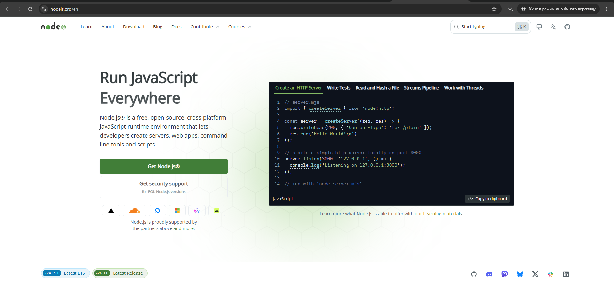

#### 1.3 Встановлення оточення виконання

Код, який програміст пише в редакторі, — це звичайний текстовий файл із набором символів. Процесор комп'ютера не вміє читати вихідний код мовами JavaScript, PHP чи Python напряму, оскільки апаратне забезпечення розуміє виключно двійкові машинні інструкції (нулі та одиниці).

Для того, щоб перетворити текст програми на працюючий застосунок, необхідне спеціалізоване програмне забезпечення — **оточення виконання (Runtime Environment)** або компілятор.

---

##### 1.3.1 Загальне поняття оточення виконання (Runtime Environment)

**Runtime Environment (оточення виконання)** — це комплекс програмних засобів, бібліотек, системних інтерфейсів та служб управління пам'яттю, які забезпечують запуск та виконання коду програми на комп'ютері чи сервері.

За способом перетворення вихідного коду мови програмування поділяються на:
- **Компульовані (C, C++, Rust, Go):** код програми заздалегідь транслюється спеціальною програмою (компілятором) у бінарний машинний код конкретної операційної системи та архітектури процесора (наприклад, файли `.exe` або виконувані ELF-бінарники). Отриманий файл запускається безпосередньо операційною системою.
- **Інтерпретовані та JIT-компільовані (JavaScript, PHP, Python, Java, C#):** код не перетворюється на самостійний бінарний файл заздалегідь. Натомість під час запуску спеціальна програма — інтерпретатор або віртуальна машина — читає код, перетворює його на проміжне представлення (байт-код або AST) і виконує його в пам'яті за допомогою JIT-компілятора (Just-In-Time) або віртуальної машини.

###### Архітектура типового Runtime Environment

Оточення виконання складається з таких ключових компонентів:

- **Рушій / Інтерпретатор (Execution Engine):**
  - перетворює вихідний текст на абстрактне синтаксичне дерево (AST — Abstract Syntax Tree);
  - компілює AST у внутрішній байт-код;
  - виконує байт-код у віртуальній машині або застосовує JIT-компіляцію для прямого виконання "гарячих" ділянок коду на процесорі (як це робить рушій V8 у Node.js).
- **Служба управління пам'яттю (Memory Management & Garbage Collector):**
  - виділяє оперативну пам'ять під змінні, масиви та об'єкти (стек і купа — Stack & Heap);
  - автоматично очищує пам'ять від об'єктів, які більше не використовуються програмою (збирач сміття — Garbage Collector).
- **Стандартна бібліотека (Standard Library):**
  - базовий набір вбудованих функцій, класів та модулів, доступних у мові "з коробки" (математичні обчислення, робота з рядками, датами, регулярними виразами).
- **Системні API та інтерфейси введення/виведення (System APIs & I/O Bindings):**
  - міст між середовищем виконання та операційною системою для взаємодії з файловою системою, мережевими сокетами, системним таймером, терміналом і процесами.

###### Порівняння архітектури оточень: Node.js, PHP та Python

| Характеристика | Node.js | PHP | Python |
| :--- | :--- | :--- | :--- |
| **Основний рушій** | V8 (Google Chrome) | Zend Engine | CPython |
| **Модель виконання** | Асинхронна, однопотокова з подієвим циклом (Event Loop / libuv) | Синхронна, "Shared-Nothing" (новий процес/потік на кожен HTTP-запит) | Синхронна з можливістю асинхронності (GIL — Global Interpreter Lock, asyncio) |
| **Оптимізація коду** | JIT-компіляція (Just-In-Time) машинного коду на льоту | OPcache (кешування байт-коду) + JIT (починаючи з PHP 8.0) | Компіляція у байт-код (`.pyc` файли у папці `__pycache__`) |
| **Типове застосування** | Високонавантажені API, мікросервіси, рендеринг фронтенду (SSR), WebSocket-сервери | Традиційні монолітні вебзастосунки, CMS (WordPress), бекенд-фреймворки (Laravel, Symfony) | Data Science, машинне навчання, наукові обчислення, автоматизація, бекенд (Django, FastAPI) |

---

##### 1.3.2 Змінні середовища (Environment variables) та робота з файлами `.env`

###### Що таке змінні середовища (Environment Variables)

**Змінні середовища** — це пари "ім'я-значення", які зберігаються на рівні операційної системи або конкретного сеансу оболонки терміналу. Коли операційна система запускає будь-яку програму, вона автоматично передає їй копію системних змінних середовища.

Змінні середовища виконують дві найважливіші функції:
- визначають шляхи до виконуваних програм (змінна `PATH`);
- передають конфігураційні параметри програмам без зміни їхнього вихідного коду (режим запуску, порти сервера, параметри підключення до баз даних).

###### Системна змінна `PATH`

Найважливішою для розробника є системна змінна `PATH`. Вона містить перелік папок операційної системи, розділених крапкою з комою `;` (у Windows) або двокрапкою `:` (у Linux/macOS).

Коли ви вводите в терміналі будь-яку команду (наприклад, `node`, `php`, `git` або `python`), операційна система діє за таким алгоритмом:
- перевіряє, чи не є ця команда вбудованою функцією поточної оболонки (Shell Builtin);
- шукає виконуваний файл із такою назвою у поточній папці;
- по черзі перевіряє кожну директорію, зазначену в змінній `PATH`;
- якщо файл знайдено — запускає його; якщо жодна папка зі списку не містить шуканого файлу — термінал повертає помилку.

*Типова помилка при відсутності шляху до програми у змінній `PATH`:*

```text
# Помилка у Windows PowerShell / CMD:
'node' is not recognized as an internal or external command,
operable program or batch file.

# Помилка у Bash / Git Bash:
bash: node: command not found
```

*Як переглянути вміст змінної `PATH`:*

```powershell
# У PowerShell:
$env:Path -split ';'

# У Bash / Git Bash / macOS:
echo $PATH | tr ':' '\n'
```

*Як перевірити точне розташування виконуваного файлу:*

```powershell
# У PowerShell:
Get-Command node

# У Bash / Linux / macOS / Git Bash:
which node
```

*Приклад відповіді терміналу:*

```bash
$ which node
/c/Program Files/nodejs/node
```

> **Важливо:** Якщо після встановлення Node.js, PHP чи Python термінал повідомляє, що команда не знайдена — обов'язково закрийте і відкрийте вікно терміналу знову, щоб оболонка перечитала оновлений вміст системних змінних середовища.

###### Конфігурація застосунків за методологією "Twelve-Factor App"

Згідно із сучасними стандартами інженерії програмного забезпечення (**The Twelve-Factor App**, розділ III "Config"):
- конфігурація проєкту (особливо конфіденційні паролі, ключі шифрування, токени API та адреси баз даних) ніколи не повинна зберігатися у вихідному коді програми;
- конфігурація має передаватися застосунку через змінні середовища.

###### Файли `.env` та шаблон `.env.example`

Для зручного локального керування параметрами в процесі розробки використовують спеціальний файл конфігурації з назвою `.env` (environment).

*Правила оформлення файлу `.env`:*
- пари ключ-значення записуються у форматі `KEY=value`;
- назви змінних пишуться великими літерами у стилі `SCREAMING_SNAKE_CASE`;
- пробіли навколо знака рівності `=` неприпустимі;
- значення з пробілами чи спеціальними символами беруться в лапки;
- коментарі починаються із символу `#`.

*Приклад робочого файлу `.env`:*

```ini
# Режим роботи застосунку (development / production)
APP_ENV=development
APP_PORT=3000

# Підключення до бази даних
DB_HOST=127.0.0.1
DB_PORT=3306
DB_NAME=student_portal
DB_USER=root
DB_PASSWORD=secret_password_123

# Секретні ключі API
JWT_SECRET=b68cf2389a9c1e285a81e9f1a23e5904
STRIPE_API_KEY=sk_test_51Mz982AbCdEfGhIjKlMn
```

*Правила безпеки при роботі з `.env`:*
- **Файл `.env` суворо заборонено додавати до Git!** Його необхідно обов'язково внести до файлу `.gitignore`. Якщо файл `.env` із реальними паролями чи платіжними ключами потрапить до публічного репозиторію GitHub, його можуть перехопити автоматичні боти протягом кількох секунд.
- **Обов'язкове створення `.env.example`:** це файл-шаблон, який містить перелік усіх необхідних змінних із пустими значеннями або демонстраційними заглушками. Файл `.env.example` комітиться в Git і слугує інструкцією для інших розробників.

*Приклад файлу `.env.example`:*

```ini
APP_ENV=development
APP_PORT=3000

DB_HOST=localhost
DB_PORT=3306
DB_NAME=database_name
DB_USER=db_user
DB_PASSWORD=your_password_here

JWT_SECRET=your_jwt_secret_token
```

Коли інший розробник завантажує проєкт із репозиторію, він створює локальну копію файлу за допомогою команди:

```bash
# Скопіювати шаблон у робочий файл .env
cp .env.example .env
```

###### Читання змінних середовища у різних мовах програмування

**1. У Node.js:**

У сучасному Node.js (починаючи з версії 20.6.0) файли `.env` підтримуються нативно за допомогою прапорця `--env-file`:

```bash
node --env-file=.env app.js
```

Або через популярну бібліотеку `dotenv`:

```javascript
// index.js
import 'dotenv/config';

const port = process.env.APP_PORT || 3000;
const dbUser = process.env.DB_USER;

console.log(`Сервер запускається на порті: ${port}`);
console.log(`Користувач БД: ${dbUser}`);
```

**2. У PHP:**

У PHP змінні середовища зчитуються через суперглобальний масив `$_ENV` або функцію `getenv()` (зазвичай у поєднанні з бібліотекою `vlucas/phpdotenv`):

```php
<?php
// Читання вбудованої змінної
$environment = getenv('APP_ENV') ?: 'production';
$dbPassword = $_ENV['DB_PASSWORD'] ?? 'default_pass';

echo "Режим: " . $environment . PHP_EOL;
```

**3. У Python:**

У Python доступ до змінних середовища реалізовано через модуль стандартної бібліотеки `os` та бібліотеку `python-dotenv`:

```python
import os
from dotenv import load_dotenv

# Завантаження змінних з файлу .env у пам'ять
load_dotenv()

app_env = os.environ.get('APP_ENV', 'development')
db_user = os.getenv('DB_USER')

print(f"Поточний режим застосунку: {app_env}")
print(f"Користувач БД: {db_user}")
```

---

##### 1.3.3 Встановлення і налаштування оточення виконання Node.js

**Node.js** — це середовище виконання JavaScript, побудоване на рушії Chrome V8 та асинхронній бібліотеці введення/виведення `libuv`. Node.js дозволяє запускати код JavaScript поза браузером: на локальній машині розробника, на вебсерверах та у хмарних контейнерах.

###### Вибір між версіями LTS та Current

На офіційному сайті розробникам пропонуються дві гілки версій:
- **LTS (Long Term Support — Довготривала підтримка):** версії з парними номерами (наприклад, Node.js 18, 20, 22). Ці версії підтримуються спільнотою протягом 30 місяців, отримують регулярні виправлення помилок безпеки та гарантують стабільність API. Саме версії LTS є стандартом для комерційної розробки, лабораторних робіт та навчальних курсів.
- **Current (Поточна версія):** версії з непарними номерами (наприклад, Node.js 21, 23). Містять найновіші експериментальні можливості мови, але можуть змінювати поведінку функцій і мати несумісність зі сторонніми бібліотеками. Не рекомендуються для початківців та стабільних проєктів.

  
*Головна сторінка офіційного сайту nodejs.org із вибором версії LTS*

###### Встановлення Node.js

**Встановлення на Windows:**
- відкрийте офіційний сайт [nodejs.org](https://nodejs.org/);
- завантажте рекомендований інсталятор **LTS** (файл із розширенням `.msi`);
- запустіть інсталятор і пройдіть майстер установки;
- на екрані вибору компонентів переконайтеся, що позначено пункт **"Add to PATH"**;
- пункт "Tools for Native Modules" (встановлення Python та Visual Studio Build Tools для компіляції C++ розширень) можна пропустити, якщо ви не плануєте збирати специфічні низькорівневі C++ модулі;
- альтернативний спосіб встановлення через термінал Windows за допомогою `winget`:
  ```powershell
  winget install OpenJS.NodeJS.LTS
  ```

**Встановлення на macOS:**
- завантажте інсталятор `.pkg` з сайту, або встановіть через пакетний менеджер Homebrew:
  ```bash
  brew install node@20
  ```

**Встановлення на Linux (Ubuntu/Debian):**
- рекомендується встановлювати через офіційний репозиторій NodeSource:
  ```bash
  # Додавання репозиторію Node.js 20 LTS
  curl -fsSL https://deb.nodesource.com/setup_20.x | sudo -E bash -
  sudo apt-get install -y nodejs
  ```

###### Перевірка встановлення та версій

Після завершення установки відкрийте новий термінал і виконайте команди для перевірки:

```bash
$ node -v
v20.18.0

$ npm -v
10.8.2

$ npx -v
10.8.2
```

###### Робота в інтерактивній консолі Node.js REPL

Node.js містить режим **REPL (Read-Eval-Print Loop)**, який дозволяє виконувати фрагменти коду JavaScript у реальному часі безпосередньо в терміналі.

*Приклад сесії REPL:*

```bash
$ node
Welcome to Node.js v20.18.0.
Type ".help" for more information.
> const user = "Student";
undefined
> console.log(`Hello, ${user}!`);
Hello, Student!
undefined
> 2 ** 10
1024
> process.version
'v20.18.0'
> process.platform
'win32'
> .exit
```

> **Порада:** Для швидкого виходу з режиму Node REPL натисніть комбінацію клавіш `Ctrl + C` двічі або введіть команду `.exit`.

###### Запуск файлу скрипту

Створіть у редакторі файл `index.js`:

```javascript
// index.js
console.log("Середовище Node.js успішно налаштовано!");
console.log("Поточна директорія:", process.cwd());
```

Виконайте запуск файлу у терміналі:

```bash
$ node index.js
Середовище Node.js успішно налаштовано!
Поточна директорія: C:\projects\my-app
```

---

##### 1.3.4 Встановлення і налаштування оточення виконання PHP

**PHP (Hypertext Preprocessor)** — популярна серверна мова програмування для веброзробки. На відміну від Node.js, який за замовчуванням слухає HTTP-порти самостійно, PHP історично орієнтований на спільну роботу з вебсервером (Apache або Nginx).

Сучасний PHP (версії 8.2, 8.3 та 8.4) — це швидка мова зі строгою типізацією, атрибутами, конструктором зі спрощеним оголошенням властивостей та JIT-компілятором.

###### Способи встановлення PHP

**1. Готові комплексні пакети (для початківців під Windows):**
- **XAMPP / Laragon:** встановлюють одночасно PHP, вебсервер Apache або Nginx та СУБД MySQL. Це найпростіший шлях для швидкого старту на домашньому комп'ютері.

**2. Автономне встановлення PHP (рекомендований спосіб):**
- завантажте архів PHP з офіційного сайту [windows.php.net/download](https://windows.php.net/download/) (версія **VS16 x64 Thread Safe** для роботи з Apache або **Non Thread Safe** для роботи з IIS чи в режимі CLI);
- розпакуйте архів у системну папку (наприклад, `C:\php`);
- додайте шлях `C:\php` до системної змінної `PATH` (через меню *Властивості системи -> Змінні середовища* або утиліту `sysdm.cpl`);
- на macOS через Homebrew:
  ```bash
  brew install php
  ```
- на Linux (Ubuntu/Debian):
  ```bash
  sudo apt update
  sudo apt install -y php-cli php-mbstring php-xml php-curl php-mysql php-zip
  ```

###### Перевірка встановлення

```bash
$ php -v
PHP 8.3.12 (cli) (built: Sep 24 2024 14:15:30) (NTS Visual C++ 2019 x64)
Copyright (c) The PHP Group
Zend Engine v4.3.12, Copyright (c) Zend Technologies
```

###### Базове налаштування конфігураційного файлу `php.ini`

Налаштування поведінки PHP здійснюється через файл `php.ini`.

1. Знайдіть розташування активного файлу `php.ini`:
   ```bash
   php --ini
   ```
   *Приклад виводу:*
   ```text
   Configuration File (php.ini) Path: C:\php
   Loaded Configuration File:         C:\php\php.ini
   Scan for additional .ini files in: (none)
   ```
2. Якщо файл `php.ini` відсутній у директорії, скопіюйте файл `php.ini-development` та перейменуйте його на `php.ini`.
3. Відкрийте `php.ini` у VS Code та розкоментуйте (видаліть крапку з комою `;` на початку рядка) життєво необхідні розширення:
   ```ini
   ; Вмикаємо директорію для розширень у Windows
   extension_dir = "ext"

   ; Обов'язкові розширення для сучасної веброзробки та роботи з Composer:
   extension=curl
   extension=fileinfo
   extension=mbstring
   extension=openssl
   extension=pdo_mysql
   extension=zip
   ```
4. Налаштуйте параметри відображення помилок для комфортної локальної розробки:
   ```ini
   display_errors = On
   display_startup_errors = On
   error_reporting = E_ALL
   memory_limit = 256M
   upload_max_filesize = 64M
   post_max_size = 64M
   date.timezone = "Europe/Kyiv"
   ```

5. Перевірте, чи успішно завантажені увімкнені модулі:
   ```bash
   php -m | grep -E "curl|mbstring|pdo_mysql|openssl"
   ```

###### Вбудований вебсервер PHP (Built-in Development Server)

Для виконання практичних і лабораторних робіт немає необхідності щоразу запускати важкий комплекс Apache або Nginx. PHP має зручний вбудований вебсервер для локальної розробки:

```bash
# Запуск сервера на порту 8000 у поточній папці
php -S localhost:8000
```

Якщо публічні файли вашого проєкту розташовані у підпапці `public/` (як у Laravel або класичному MVC-застосунку):

```bash
php -S localhost:8000 -t public
```

*Приклад консольного виводу працюючого сервера:*

```text
[Mon Oct 14 17:15:00 2026] PHP 8.3.12 Development Server (http://localhost:8000) started
[Mon Oct 14 17:15:10 2026] [200]: GET / - Accepted
[Mon Oct 14 17:15:10 2026] [200]: GET /style.css - Closing
```

---

##### 1.3.5 Встановлення і налаштування оточення виконання Python

**Python** — багатоцільова інтерпретована мова програмування, що відрізняється лаконічним синтаксисом та надзвичайно багатою екосистемою бібліотек.

###### Встановлення Python

> **Критично важливо:** Підтримка другої гілки Python (Python 2.x) офіційно завершилася у 2020 році. Усі сучасні навчальні курси, бібліотеки та фреймворки створюються виключно для **Python 3** (рекомендовані версії: Python 3.11, 3.12 або 3.13).

**Встановлення на Windows:**
- відкрийте офіційний сайт [python.org/downloads](https://www.python.org/downloads/);
- завантажте останній стабільний реліз Python 3.x;
- запустіть інсталятор і **на найпершому екрані обов'язково поставте прапорець "Add python.exe to PATH"**;
- натисніть кнопку "Customize installation", переконайтеся, що вибрано пункти `pip`, `tcl/tk` та `py launcher`;
- на фінальному екрані інсталяції натисніть **"Disable path length limit"** (зняття обмеження Windows на максимальну довжину шляху у 260 символів, що допоможе уникнути помилок при роботі з вкладеними бібліотеками);
- альтернативне встановлення через консоль Windows:
  ```powershell
  winget install Python.Python.3.12
  ```

**Встановлення на Linux та macOS:**
- у дистрибутивах Linux Python 3 зазвичай встановлено як частину системних утиліт:
  ```bash
  sudo apt update
  sudo apt install -y python3 python3-pip python3-venv
  ```
- на macOS через Homebrew:
  ```bash
  brew install python
  ```

###### Перевірка встановлення

```bash
$ python --version
Python 3.12.6

$ pip --version
pip 24.2 from C:\Users\Student\AppData\Local\Programs\Python\Python312\Lib\site-packages\pip (python 3.12)
```

###### Утиліта запуску Python Launcher для Windows (`py`)

У Windows разом із Python встановлюється спеціальна службова утиліта `py.exe` (Python Launcher). Вона автоматично визначає встановлені версії інтерпретатора і дозволяє запускати потрібну версію:

```powershell
# Перелік усіх встановлених у системі версій Python
py -0

# Запуск коду конкретною версією інтерпретатора
py -3.11 script.py
py -3.12 script.py
```

###### Робота в інтерактивній консолі Python

```bash
$ python
Python 3.12.6 (tags/v3.12.6:a4a8b24, Sep  6 2024, 20:19:19) [MSC v.1940 64 bit (AMD64)] on win32
Type "help", "copyright", "credits" or "license" for more information.
>>> print("Ласкаво просимо до Python!")
Ласкаво просимо до Python!
>>> numbers = [1, 2, 3, 4, 5]
>>> [x * 2 for x in numbers if x % 2 != 0]
[2, 6, 10]
>>> exit()
```

---

##### 1.3.6 Робота з пакетним менеджером Node.js (npm, yarn, pnpm) та NVM

**Пакетний менеджер** — це інструмент, який автоматизує завантаження, оновлення, налаштування та видалення сторонніх бібліотек (залежностей) у проєкті.

###### Анатомія проєкту Node.js: `package.json` та Lockfile

Будь-який проєкт Node.js починається з файлу `package.json`, який описує метадані проєкту, встановлені пакети та призначені для терміналу команди.

Ініціалізація нового проєкту:

```bash
# Інтерактивне створення файлу package.json
npm init

# Швидке створення з налаштуваннями за замовчуванням
npm init -y
```

*Приклад структури файлу `package.json`:*

```json
{
  "name": "my-web-project",
  "version": "1.0.0",
  "type": "module",
  "scripts": {
    "dev": "vite",
    "build": "vite build",
    "lint": "eslint ."
  },
  "dependencies": {
    "axios": "^1.7.7"
  },
  "devDependencies": {
    "eslint": "^9.12.0",
    "vite": "^5.4.8"
  }
}
```

###### Різниця між `dependencies` та `devDependencies`

- **`dependencies` (виробничі залежності):** бібліотеки, необхідні для безпосередньої роботи вашого застосунку у користувача (наприклад, фреймворки `express`, `react`, бібліотеки для роботи з мережею `axios` чи базою даних `pg`). Встановлюються командою:
  ```bash
  npm install axios
  ```
- **`devDependencies` (залежності для розробки):** інструменти, потрібні виключно програмісту під час написання коду (лінтери `eslint`, засоби автоформатування `prettier`, компілятори `typescript`, тестові фреймворки `vitest`, сервери збірки `vite`). Ці пакети не потрапляють у фінальну збірку для продакшену. Встановлюються з прапорцем `-D` (або `--save-dev`):
  ```bash
  npm install -D eslint prettier
  ```

###### Значення та важливість `package-lock.json`

Під час встановлення першого пакета npm автоматично створює файл `package-lock.json`. 

- Він фіксує точну версію кожного встановленого пакета (до конкретного бінарного хешу), а також версії всіх його підзалежностей.
- Це гарантує так звану **детермінованість збірки**: у будь-якого іншого розробника вашої команди або на сервері збірки проєкт встановить абсолютно ідентичні версії бібліотек без сюрпризів чи несумісностей.
- **Файл `package-lock.json` обов'язково комітиться в Git!**
- Для розгортання проєкту на сервері чи під час перевірки робіт використовується команда чистки й точного відновлення версій:
  ```bash
  npm ci
  ```
  *(Команда `npm ci` — Clean Install — видаляє існуючу папку `node_modules` і встановлює залежності суворо згідно з `package-lock.json` без оновлення версій).*

###### Папка `node_modules` та файл `.gitignore`

Усі завантажені бібліотеки зберігаються в директорії `node_modules/`. Ця папка може важити сотні мегабайтів і містити десятки тисяч дрібних файлів.

> **Суворе правило:** Папку `node_modules/` **категорично заборонено** передавати в репозиторій Git або надсилати викладачу в архівах! Її обов'язково вносять у `.gitignore`. Кожен, хто завантажує ваш репозиторій, відновлює всі бібліотеки однією командою: `npm install`.

###### Локальна vs Глобальна установка пакетів

- **Локальна установка (без прапорця `-g`):** пакети встановлюються всередину поточної папки проєкту в `node_modules/`. Це стандартний та безпечний підхід, який ізолює кожен проєкт від іншого.
- **Глобальна установка (прапорець `-g`):** пакет встановлюється в системну директорію користувача і стає доступним як утиліта з будь-якого місця терміналу.
  - *Недоліки:* різні проєкти можуть вимагати різних версій одного й того самого глобального пакета; можливі помилки прав доступу під час встановлення.
  - *Сучасна альтернатива:* використання утиліти **`npx`** (Node Package Execute). Вона завантажує пакет у тимчасовий кеш, одноразово виконує його і видаляє після завершення:
  ```bash
  # Виконання генератора проєкту Vite без попереднього глобального встановлення
  npx create-vite@latest my-app --template vanilla
  ```

###### Порівняння менеджерів: `npm`, `yarn` та `pnpm`

| Характеристика | npm (Node Package Manager) | yarn (від Meta) | pnpm (Performant npm) |
| :--- | :--- | :--- | :--- |
| **Швидкість роботи** | Середня | Висока (паралельне завантаження) | Найвища (моментальне створення лінків) |
| **Використання диска** | Копіює всі файли в кожен окремий проєкт у `node_modules` | Копіює файли або використовує PnP (Plug'n'Play) | Використовує глобальне спільне сховище та жорсткі посилання (Hard Links) |
| **Захист від Phantom Dependencies** | Слабкий (пласка структура розкриває непрямі залежності) | Залежить від режиму | Абсолютний (сувора ізоляція структури) |
| **Lock-файл** | `package-lock.json` | `yarn.lock` | `pnpm-lock.yaml` |

**Чому `pnpm` став новим стандартом індустрії:**  
Якщо у вас на диску 10 проєктів, які використовують бібліотеку розміром 50 МБ, `npm` скопіює її 10 разів (зайнявши 500 МБ місця). Менеджер `pnpm` збереже її на диск лише один раз у глобальне сховище (`~/.pnpm-store`), а в папки проєктів створить жорсткі посилання (Hard Links), заощаджуючи десятки гігабайтів дискового простору.

```bash
# Встановлення pnpm через стандартний npm
npm install -g pnpm

# Використання pnpm аналогічно до npm
pnpm install
pnpm add lodash
pnpm run dev
```

###### Керування версіями Node.js за допомогою NVM (Node Version Manager)

У реальній практиці різні проєкти часто потребують різних версій Node.js (наприклад, старий проєкт підтримки працює лише на Node.js 16, а новий навчальний проєкт — на Node.js 20 або 22).

**NVM** дозволяє встановлювати необмежену кількість версій Node.js на один комп'ютер та перемикатися між ними за частку секунди.

- Для Windows використовується: **[nvm-windows](https://github.com/coreybutler/nvm-windows)** (завантажується інсталятор `nvm-setup.exe`);
- Для Linux та macOS використовується оригінальний скрипт: **[nvm-sh/nvm](https://github.com/nvm-sh/nvm)**.

*Основні команди роботи з NVM:*

```bash
# Перегляд списку доступних версій для завантаження (у Windows)
nvm list available

# Встановлення потрібної версії
nvm install 20.18.0
nvm install 18.20.4

# Перегляд уже встановлених локально версій
$ nvm list
  * 20.18.0 (Currently using 64-bit executable)
    18.20.4

# Перемикання на іншу версію
$ nvm use 18.20.4
Now using node v18.20.4 (64-bit)

# Перевірка поточної активної версії
$ node -v
v18.20.4
```

> **Порада:** У корінь проєкту можна додати файл `.nvmrc` із зазначенням версії (наприклад, `20.18.0`). Тоді розробнику достатньо виконати команду `nvm use`, і NVM автоматично активує вказану для цього проєкту версію.

---

##### 1.3.7 Робота з пакетним менеджером PHP (Composer)

**Composer** — це загальновизнаний стандарт для управління бібліотеками та залежностями в екосистемі мови PHP.

###### Встановлення та перевірка Composer

- На Windows завантажте та запустіть офіційний інсталятор **`Composer-Setup.exe`** з сайту [getcomposer.org](https://getcomposer.org/). Під час установки вкажіть шлях до файлу `php.exe`.
- На macOS:
  ```bash
  brew install composer
  ```
- На Linux:
  ```bash
  sudo apt install -y composer
  ```

*Перевірка встановлення у терміналі:*

```bash
$ composer -V
Composer version 2.7.9 2024-09-04 14:43:28
PHP version 8.3.12 (C:\php\php.exe)
Run the "diagnose" command to get more details
```

###### Структура проєкту з Composer: `composer.json` та `composer.lock`

- **`composer.json`** — головний маніфест проєкту, в якому зазначаються вимоги до версії самого PHP, необхідні розширення та сторонні пакети:

```json
{
  "name": "student/task-tracker",
  "description": "Навчальний проєкт на чистому PHP за патерном MVC",
  "type": "project",
  "require": {
    "php": "^8.2",
    "vlucas/phpdotenv": "^5.6",
    "monolog/monolog": "^3.7"
  },
  "require-dev": {
    "phpunit/phpunit": "^11.3"
  },
  "autoload": {
    "psr-4": {
      "App\\": "src/"
    }
  }
}
```

- **`composer.lock`** — файл, що містить повний зліпок зафіксованих версій бібліотек із контрольними сумами комітів. Обов'язково додається до Git!
- **Папка `vendor/`** — директорія, куди завантажуються всі бібліотеки сторонніх авторів. **Обов'язково додається до `.gitignore`!**

###### Автозавантаження класів за стандартом PSR-4

Раніше розробникам на PHP доводилося писати довгі списки директив `require_once 'path/to/Class.php'` на початку кожного файлу. 

Composer вирішив цю проблему завдяки підтримці стандарту автозавантаження **PSR-4**:
- кожен простір імен (namespace) прив'язується до певної директорії на диску;
- наприклад, рядок `"App\\": "src/"` означає: клас `App\Controllers\UserController` повинен автоматично завантажуватися з файлу `src/Controllers/UserController.php`.

Все, що потрібно зробити розробнику — це підключити єдиний файл завантажувача на самому початку точки входу застосунку (`index.php`):

```php
<?php
// public/index.php

// Підключаємо універсальний автозавантажувач класів Composer
require_once __DIR__ . '/../vendor/autoload.php';

use App\Controllers\UserController;
use Monolog\Logger;
use Monolog\Handler\StreamHandler;

// Створення об'єкта логера сторонньої бібліотеки
$log = new Logger('main');
$log->pushHandler(new StreamHandler(__DIR__ . '/../app.log', Logger::DEBUG));
$log->info('Застосунок успішно стартував!');

// Створення об'єкта власного класу
$controller = new UserController();
$controller->render();
```

###### Основні команди Composer

- `composer init` — покрокове створення нового файлу `composer.json` в діалоговому режимі;
- `composer require <vendor>/<package>` — встановлення нової бібліотеки для проєкту:
  ```bash
  $ composer require vlucas/phpdotenv
  ./composer.json has been updated
  Running composer update vlucas/phpdotenv
  Loading composer repositories with package information
  Updating dependencies
  Lock file operations: 3 installs, 0 updates, 0 removals
    - Locking graham-campbell/result-type (v1.1.3)
    - Locking phpoption/phpoption (1.9.3)
    - Locking vlucas/phpdotenv (v5.6.1)
  Writing lock file
  Installing dependencies from lock file (including require-dev)
  Package operations: 3 installs, 0 updates, 0 removals
    - Downloading vlucas/phpdotenv (v5.6.1)
    - Installing vlucas/phpdotenv (v5.6.1): Extracting archive
  Generating autoload files
  ```
- `composer require --dev <vendor>/<package>` — встановлення інструментів для розробки (наприклад, фреймворку тестування PHPUnit);
- `composer install` — встановлення точних версій пакетів, зафіксованих у `composer.lock` (використовується під час розгортання проєкту з репозиторію);
- `composer update` — оновлення всіх пакетів до найновіших допустимих версій згідно з правилами у `composer.json` та оновлення файлу `composer.lock`;
- `composer dump-autoload -o` — перегенерація оптимізованої карти класів (Classmap) автозавантажувача після створення нових файлів або перейменування просторів імен;
- `composer check-platform-reqs` — перевірка відповідності поточної конфігурації PHP (версії та наявності розширень) вимогам проєкту:
  ```bash
  $ composer check-platform-reqs
  Checking platform requirements for packages in the vendor dir
  ext-curl         8.3.12   success
  ext-mbstring     8.3.12   success
  ext-openssl      8.3.12   success
  php              8.3.12   success
  ```

---

##### 1.3.8 Робота з пакетним менеджером Python (pip та venv)

###### Що таке `pip` та проблема глобального простору пакетів

**`pip` (Package Installer for Python)** — це офіційний менеджер пакетів для мови Python, що завантажує бібліотеки з публічного сховища **PyPI (Python Package Index)**.

У Python існує критично важлива особливість: якщо ви виконаєте команду `pip install requests` без попереднього налаштування, цей пакет встановиться **глобально** у спільну системну папку Python.

*Чому глобальне встановлення пакетів вважається антипатерном:*
- якщо проєкт "A" потребує старішої версії бібліотеки `Django==4.2`, а проєкт "B" — нової `Django==5.1`, вони перезапишуть один одного та призведуть до непрацездатності коду;
- у сучасних версіях Linux спроба встановити пакет глобально призводить до блокування операційною системою із захисною помилкою `PEP 668: error: externally-managed-environment`, щоб користувач не зламав системні службові утиліти Linux.

###### Віртуальне середовище (`venv`): принцип роботи

**Віртуальне середовище (Virtual Environment)** — це повністю ізольована папка всередині вашого проєкту, яка містить власну копію інтерпретатора Python, власний менеджер `pip` та власну папку для завантаження сторонніх бібліотек (`site-packages`).

###### Покроковий алгоритм роботи з `venv`

**Крок 1. Створення ізольованого середовища у проєкті:**

Перейдіть у кореневу папку вашого проєкту в терміналі та виконайте:

```bash
# Створити віртуальне середовище у прихованій папці .venv
python -m venv .venv
```

*(Замість `.venv` можна вказати будь-яку назву папки, але назва `.venv` або `venv` є загальноприйнятим стандартом в індустрії).*

**Крок 2. Активація віртуального середовища:**

Команди активації відрізняються залежно від операційної системи та оболонки:

```powershell
# У Windows PowerShell:
.\.venv\Scripts\Activate.ps1

# У Windows Command Prompt (cmd.exe):
.\.venv\Scripts\activate.bat

# У Linux, macOS або Git Bash:
source .venv/bin/activate
```

*Приклад консолі після успішної активації:*

Зверніть увагу: перед рядком запрошення терміналу з'явиться маркер у круглих дужках `(.venv)`:

```powershell
(.venv) PS C:\projects\python-weather>
```

> **Вирішення помилки заборони запуску скриптів у Windows PowerShell:**  
> Якщо під час активації виникає помилка: `File ... cannot be loaded because running scripts is disabled on this system`, відкрийте PowerShell від імені адміністратора та один раз дозвольте виконання локальних скриптів:  
> `Set-ExecutionPolicy -Scope Process -ExecutionPolicy RemoteSigned`

**Крок 3. Встановлення бібліотек всередину віртуального середовища:**

Коли середовище активоване, будь-яка команда `pip` встановлює бібліотеки виключно всередину папки `.venv` вашого проєкту:

```bash
pip install requests beautifulsoup4
```

*Приклад відповіді терміналу:*

```text
Collecting requests
  Downloading requests-2.32.3-py3-none-any.whl.metadata (4.6 kB)
Collecting beautifulsoup4
  Downloading beautifulsoup4-4.12.3-py3-none-any.whl.metadata (3.8 kB)
Installing collected packages: urllib3, idna, charset-normalizer, certifi, requests, soupsieve, beautifulsoup4
Successfully installed beautifulsoup4-4.12.3 certifi-2024.8.30 charset-normalizer-3.4.0 idna-3.10 requests-2.32.3 soupsieve-2.6 urllib3-2.2.3
```

**Крок 4. Деактивація середовища після завершення роботи:**

```bash
deactivate
```
*(Префікс `(.venv)` зникне з командного рядка).*

###### Фіксація залежностей у файлі `requirements.txt`

Щоб інший розробник міг розгорнути ваш Python-проєкт, версії всіх бібліотек фіксуються у файлі `requirements.txt`.

*1. Збереження списку встановлених бібліотек із точними версіями:*

```bash
pip freeze > requirements.txt
```

*Приклад вмісту згенерованого файлу `requirements.txt`:*

```text
beautifulsoup4==4.12.3
certifi==2024.8.30
charset-normalizer==3.4.0
idna==3.10
requests==2.32.3
soupsieve==2.6
urllib3==2.2.3
```

*2. Відновлення всіх бібліотек на новому комп'ютері:*

Отримавши проєкт з репозиторію, студент створює нове віртуальне середовище, активує його та запускає команду автоматичного відновлення:

```bash
pip install -r requirements.txt
```

> **Правило контролю версій:**  
> Папка віртуального середовища `.venv/` або `venv/` **обов'язково додається до файлу `.gitignore`**! У Git-репозиторій передається лише файл маніфесту `requirements.txt`.

---

##### 1.3.9 Зведена таблиця та контрольний чекліст готовності робочого оточення

###### Порівняльна таблиця екосистем розробки

| Параметр | JavaScript (Node.js) | PHP | Python |
| :--- | :--- | :--- | :--- |
| **Основна мова / версія** | JavaScript (ES2024) / Node 20 LTS | PHP 8.2+ | Python 3.11+ |
| **Команда перевірки версії** | `node -v` | `php -v` | `python --version` |
| **Менеджер пакетів** | `npm` (або `pnpm`, `yarn`) | `Composer` | `pip` |
| **Маніфест залежностей** | `package.json` | `composer.json` | `requirements.txt` (або `pyproject.toml`) |
| **Фіксатор версій (Lockfile)** | `package-lock.json` | `composer.lock` | Зафіксовані версії `==` у `requirements.txt` |
| **Папка сторонніх бібліотек** | `node_modules/` | `vendor/` | `.venv/Lib/site-packages/` |
| **Обов'язковий запис у `.gitignore`** | `node_modules/`, `.env` | `vendor/`, `.env` | `.venv/`, `__pycache__/`, `.env` |
| **Керування версіями середовища** | `nvm` (Node Version Manager) | Docker / системні збірки | `venv` / `pyenv` / `uv` |

###### Чекліст студента перед початком лабораторної чи практичної роботи

Перед виконанням завдань переконайтеся, що:
- термінал без помилок повертає версії потрібного середовища виконання (`node -v`, `php -v` або `python --version`);
- каталог виконання додано до змінної `PATH`;
- у корені проєкту створено файл `.gitignore`, який містить назви папок сторонніх залежностей (`node_modules/`, `vendor/`, `.venv/`) та файл конфігурації `.env`;
- секретні параметри з файлу `.env` не захардкоджені у коді ваших скриптів;
- у разі розробки на Python активовано локальне віртуальне середовище (`.venv`).
